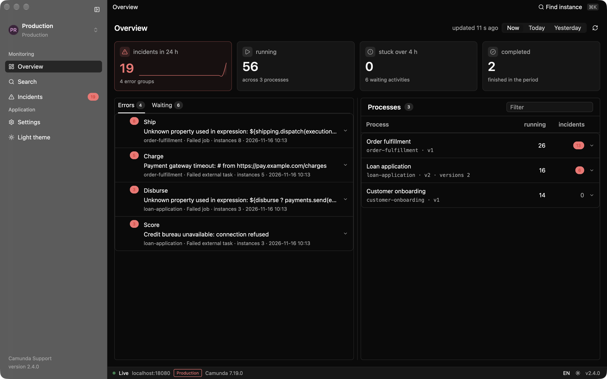
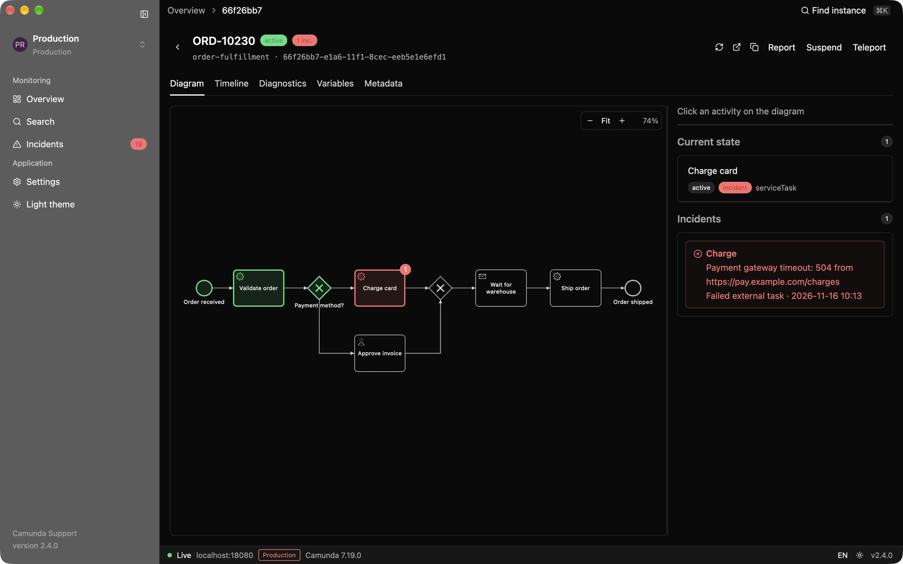
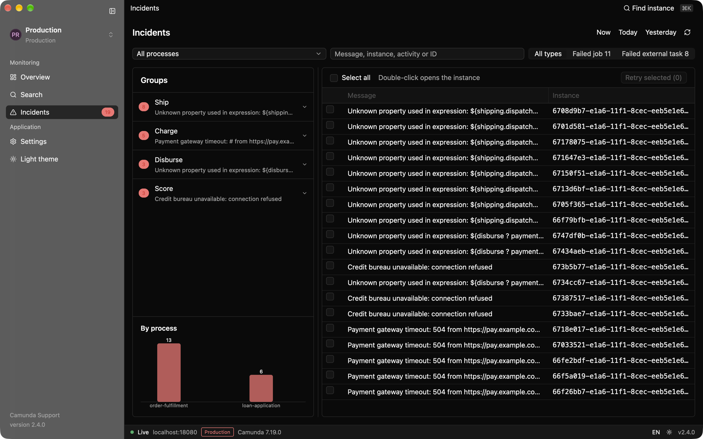
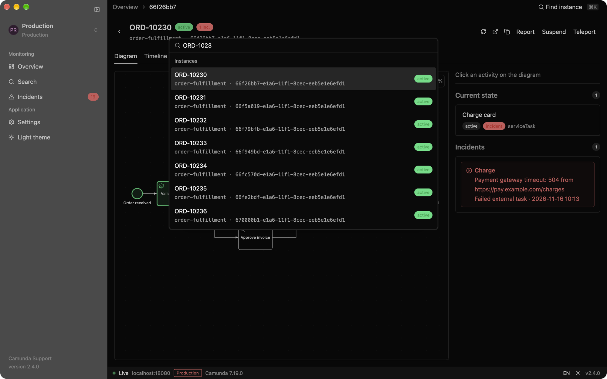
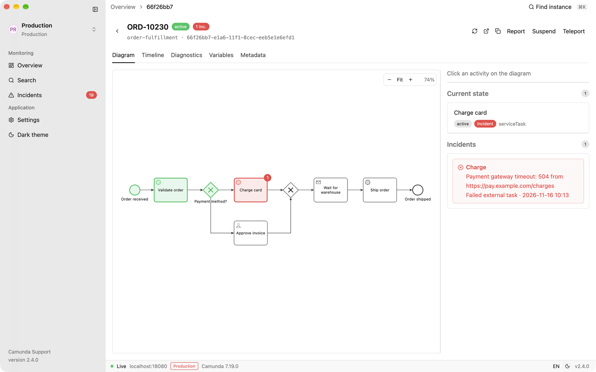

<div align="center">


# Camunda Support

**A fast native desktop console for operating Camunda 7.**
Find a stuck instance, see why it is stuck on the BPMN diagram, and fix it: retry, edit variables, move the token. No browser, no backend.

[](https://github.com/malinatrash/camunda-support-desktop/releases/latest)
[](https://github.com/malinatrash/camunda-support-desktop/actions/workflows/desktop-package.yml)
[](LICENSE)




</div>

## Why

Camunda Cockpit is built for administration. Support engineers need something else: jump from a business key to the failing activity in seconds, see every incident of the last 24 hours grouped by cause, and run a safe, confirmed fix. Camunda Support talks to the Camunda 7 REST API directly from your machine and renders everything natively on the GPU, so it opens instantly and stays smooth with thousands of rows.

## Features

- **Overview.** Live metric cards with an hourly incident sparkline, incidents of the last 24 hours grouped by activity and error signature, waiting and stuck instances, processes with every deployed version.
- **Instance view.** BPMN diagram with completed, active and failed activities, zoom and pan; timeline from the History API; diagnostics with job and external task retries; variables with search and inline editing; metadata; suspend and activate; a Markdown report for tickets.
- **Teleport.** Click an activity on the diagram to move the token there, with a reason and an explicit confirmation on production.
- **Incidents.** Filter by period, process, type and text; groups by cause; chart by process; bulk retry.
- **Search.** By business key, instance ID or any process variable, with a catalog of variable names per process.
- **⌘K palette.** Find an instance from anywhere, jump between sections with ⌘1–3 and ⌘,.
- **Deep links.** Share `camunda-support://process-instance/<id>?origin=...`; the app picks the matching connection and opens the instance.
- **Multiple engines.** Production, staging and local connections with color-coded environments and a connection check against `/engine-rest`.
- **Silent auto-update.** Checks GitHub Releases every six hours, verifies SHA-256 and installs the new version in the background; you just press Restart.
- **Native and modern.** Rust, GPUI (the engine behind the Zed editor) and GPUI Kit components; Metal, DirectX or Vulkan rendering; dark and light themes; translucent sidebar on macOS; smooth transitions and animated charts.
- **English and Russian.** English by default, Russian in Settings or with one click in the status bar.

## Screenshots

| | |
|---|---|
|  |  |
| **Instance**: diagram with token state and incidents | **Incidents**: groups, chart by process, bulk retry |
|  |  |
| **⌘K**: find an instance by business key | **Light theme** |

## Install

Download the installer for your platform from the [latest release](https://github.com/malinatrash/camunda-support-desktop/releases/latest):

| Platform | File |
|---|---|
| macOS (Apple Silicon) | `Camunda.Support_<version>_aarch64.dmg` |
| Windows x64 | `Camunda.Support_<version>_x64-setup.exe` |
| Ubuntu / Debian x64 | `camunda-support_<version>_amd64.deb` |

Packages are not signed yet. On macOS, open the app once via **System Settings → Privacy & Security → Open Anyway**.

Then add a connection in **Settings → Connections** with your engine REST URL, for example `https://camunda.example.com/engine-rest`.

## Try it with a demo engine

No Camunda at hand? Start one in Docker and seed it with demo processes, instances and incidents:

```bash
docker run -d --name camunda-demo -p 8080:8080 camunda/camunda-bpm-platform:run-7.19.0
```

```bash
python3 demo/seed.py http://localhost:8080/engine-rest
```

Add a connection to `http://localhost:8080/engine-rest`. The seed deploys three processes (order fulfillment, customer onboarding, loan application in two versions), about 50 running instances and a set of failed jobs and external tasks. The screenshots above were taken on exactly this data.

## Build from source

Requires Rust 1.95+ via rustup.

```bash
cargo run
```

```bash
cargo test --workspace
```

```bash
cargo clippy --workspace --all-targets -- --deny warnings
```

Useful environment variables:

| Variable | Effect |
|---|---|
| `CAMUNDA_SUPPORT_CONNECTION` | connection name to select on start |
| `CAMUNDA_SUPPORT_OPEN_INSTANCE` | instance ID to open on start |
| `CAMUNDA_SUPPORT_DATA_DIR` | alternative data directory (demos, testing) |

Installers locally, output in `target/release/bundle`: `packaging/macos.sh`, `packaging/linux.sh` (on Ubuntu), `packaging/windows.sh` (on Windows with NSIS).

## Project layout

```text
src/main.rs              entry point: window, theme, language, shortcuts, deep links
src/app/                 shell: sidebar, connection switcher, breadcrumbs, status bar, ⌘K palette
src/platform/            tokio bridge to the core, theme, locale, motion
src/updates/             auto-update: check, silent install, restart notice
src/model/               grouping and formatting for screens
src/bpmn/                BPMN canvas: camera, layers, labels, markers
src/views/               one folder per screen, one file per scenario
locales/                 UI strings (en, ru)
crates/camunda-core/     core: Camunda REST API by domain, models, storage, migration, deep links, updater
demo/                    demo BPMN models and seed script
packaging/               macOS .app/.dmg, Linux .deb, Windows NSIS installer
docs/                    product spec, design system, roadmap, research
```

More in the [product spec](docs/product-spec.md), [design system](docs/design-system.md), [roadmap](docs/roadmap.md) and the [stack research](docs/research/native-rust-ui.md).

## Translations

Strings live in `locales/*.yml` and `crates/camunda-core/locales/core.yml` in [rust-i18n](https://github.com/longbridge/rust-i18n) format: every key has an `en` and a `ru` value. To add a language, add its values next to the existing ones and register it in `src/platform/locale.rs`. Pull requests are welcome.

## Releases

```bash
./scripts/release.sh v2.5.0
```

The script runs the tests, writes the version to `Cargo.toml`, commits and pushes a tag. GitHub Actions checks formatting, clippy and tests, builds the Windows, macOS and Ubuntu installers and publishes a release with `SHA256SUMS.txt`.

## License

[MIT](LICENSE)
